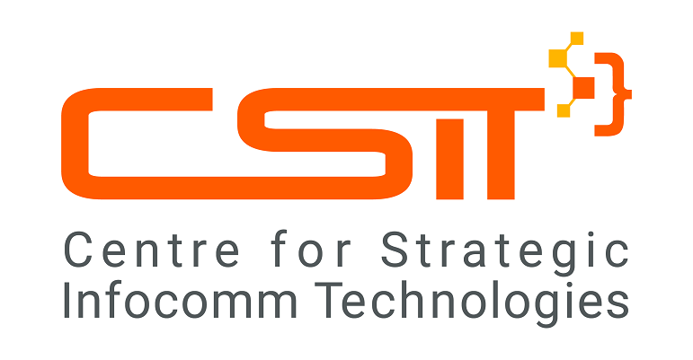

# AETHER - AI-Powered IDA Pro Reverse Engineering Plugin

    <em>
    An AI-powered reverse-engineering copilot for assisting tedious malware analysis in IDA Pro.
    </em>

  
  
  
  

---

## Table of Contents

- [Overview](#overview)
- [Key Features](#key-features)
- [Improvements over Raw IDA Pro MCP](#improvements-over-raw-ida-pro-mcp)
- [Requirements](#requirements)
- [Installation](#installation)
- [Documentation](#documentation)
- [Limitations](#limitations)
- [Contributing](#contributing)
- [Authors/Maintainers](#authorsmaintainers)
- [License](#license)
- [Acknowledgments](#acknowledgments)
- [Sources](#sources)

---

## Overview

**AETHER** is an advanced IDA Pro plugin that integrates Large Language Models (LLMs) into your reverse engineering workflow. It automates time-consuming tasks like function annotation, variable renaming, structure creation and contextual analysis, allowing security analysts to focus on deeper malware analysis and threat assessment.

The plugin leverages the IDA Pro Model Context Protocol (MCP) to communicate with LLMs while efficiently managing context and tokens. It is specifically designed for malware analysis, vulnerability research, and binary reverse engineering.

---

## Key Features

_Coming soon._

---

## Improvements over Raw IDA Pro MCP

- **Context Management**: Intelligently manages LLM context window to maximize analysis quality
- **Optimized Prompting**: Specialized prompts engineered for reverse engineering tasks
- **Token Efficiency**: Reduces token consumption while maintaining analysis quality
- **One-Shot Tool Usage**: Minimizes API calls through efficient tool interaction
- **IDA Integration**: Seamless integration with IDA Pro UI and workflows
- **Multi-Model Support**: Works with multiple LLM providers and models

---

## Requirements

### Minimum System Requirements
- **Operating System**: Windows or Linux
- **Python**: 3.12 or 3.13 (Python 3.14 is not supported by IDA Pro)
- **IDA Pro**: Version 9.2 or above

### API Requirements
- **LLM Gateway**: An OpenAI-compatible LLM gateway and API key. The default is OpenRouter, but you can configure your own provider.
- **Network**: Internet connection for LLM API calls (or a local LLM server setup)

---

## Installation

There's no hosted docs site yet, so the install guide lives in the docs. To install AETHER:

1. Run the docs site locally — see [apps/docs/README.md](apps/docs/README.md) for the `bun` setup.
2. Open `http://localhost:3000/getting-started` and follow the steps for the GUI or CLI.

---

## Documentation

All documentation lives in [`apps/docs`](apps/docs). Run docs locally (see [apps/docs/README.md](apps/docs/README.md)) and browse at `http://localhost:3000`.

---

## Limitations
- LLM's accuracy is variable
- Comments are generally less trustable than function and var names - working on it
- Occasional formatting issues now and then
- Retry actions several times for varying results if current results are unsatisfactory

---

## Contributing

For developers, see [CONTRIBUTING.md](CONTRIBUTING.md) and the **Contributing** page in the docs (`http://localhost:3000/development/contributing`) for setup and further information.

---

## Authors/Maintainers

This project is authored by:
- Ang Guang Yao ([@guangyaoa123](https://github.com/guangyaoa123))
- Ang Ian ([@Ang-Ian](https://github.com/Ang-Ian))
- Asher Cheng ([@Ash2234](https://github.com/Ash2234))
- Bryan Goh Jing Yuan ([@BryanFrFr](https://github.com/BryanFrFr))
- Chan Weng Tim ([@TimTimTimTimTimTimTimTimTimTimTimTimTi](https://github.com/TimTimTimTimTimTimTimTimTimTimTimTimTi))
- Kan Onn Kit ([@PhotonicGluon](https://github.com/PhotonicGluon))
- Leland Tan Jin Jie ([@loland](https://github.com/loland))
- Tristan Tan Jun Xian ([@loghogjog](https://github.com/loghogjog))
- Mervyn Chua ([@MervC-3151](https://github.com/MervC-3151))
- Ng Jun Han ([@GoldenStone02](https://github.com/GoldenStone02))
- Sebastian Ong ([@SebassNoob](https://github.com/SebassNoob))
- Tan Yehan ([@XxHanpowerxX](https://github.com/XxHanpowerxX))
- Theodore Lee Chong Jen ([@TheoLeeCJ](https://github.com/TheoLeeCJ))
- Zeph Teo ([@fritzthecrisp](https://github.com/fritzthecrisp))

---

## License

This project is licensed under the terms of the GPLv3 license (see `LICENSE`).

---

## Acknowledgments

This project was created and/or upgraded thanks to the following organizations and initiatives:

<body>
<h3>Centre for Strategic Infocomm Technologies</h3>

<h3>The Digital and Intelligence Service</h3>

AETHER is made possible through the dedication of Cyber Specialists under the Digital and Intelligence Service’s (DIS) Defence Cyber Command (DCCOM).

</body>

---

## Sources
- IDA Pro MCP - https://github.com/mrexodia/ida-pro-mcp/tree/main
- Plugin optimised for [`Qwen: Qwen3 Next 80B A3B Instruct`](https://openrouter.ai/qwen/qwen3-next-80b-a3b-instruct)
- Thanks to all who provided feedback and annotated IDA files
