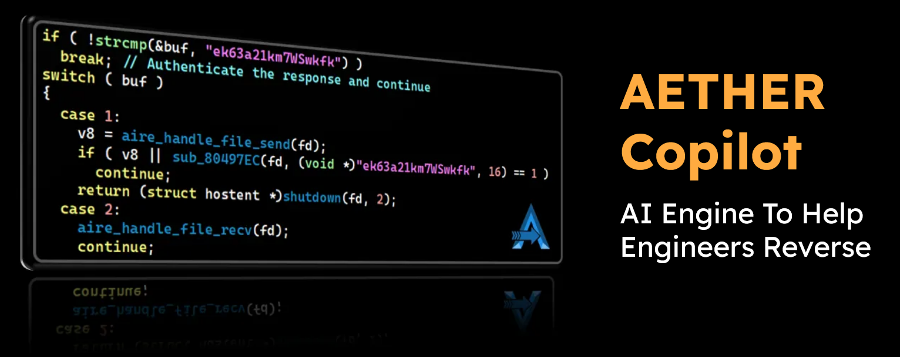

# AETHER - AI-Powered IDA Pro Reverse Engineering Plugin



<p align="center">
    <em>
    An AI-powered reverse-engineering copilot for assisting tedious malware analysis in IDA Pro.
    </em>
</p>

<p align="center">
  
  
  
</p>

---

## Table of Contents

- [AETHER - AI-Powered IDA Pro Reverse Engineering Plugin](#aether---ai-powered-ida-pro-reverse-engineering-plugin)
  - [Table of Contents](#table-of-contents)
  - [Overview](#overview)
  - [Key Features](#key-features)
  - [Improvements over Raw IDA Pro MCP](#improvements-over-raw-ida-pro-mcp)
  - [Requirements](#requirements)
    - [Minimum System Requirements](#minimum-system-requirements)
    - [API Requirements](#api-requirements)
  - [Installation](#installation)
  - [Release](#release)
  - [Documentation](#documentation)
  - [Troubleshooting](#troubleshooting)
  - [Issues and Support](#issues-and-support)
  - [Limitations](#limitations)
  - [Contributing](#contributing)
  - [Authors/Maintainers](#authorsmaintainers)
  - [License](#license)
  - [Acknowledgments](#acknowledgments)
  - [Sources](#sources)

---

## Overview

**AETHER** is an advanced IDA Pro plugin that integrates Large Language Models (LLMs) into your reverse engineering workflow. It automates time-consuming tasks like function annotation, variable renaming, structure creation and contextual analysis, allowing security analysts to focus on deeper malware analysis and threat assessment.

The plugin leverages FastMCP to communicate with LLMs while efficiently managing context and tokens. It is specifically designed for malware analysis, vulnerability research, and binary reverse engineering.

---

## Key Features

- **Annotation**: Adds comments, renames functions and variables to make decompiled code more human readable.
- **Struct Creator**: Creates and re-evaluates IDA structures from the selected variable and its surrounding context.
- **Chatbot**: Lets you converse with the decompiled code and drive other AETHER features through prompts.
- **CLI client**: Provides a headless interface for running AETHER without the IDA GUI.


**Experimental**
- **Unflattener**: Recovers readable control flow from flattened/obfuscated functions.
- **Report Generation**: Produces a malware-analysis report and YARA rules for a function.

---

## Improvements over Raw IDA Pro MCP

- **Context Management**: Intelligently manages LLM context window to maximize analysis quality
- **Optimized Prompting**: Specialized prompts engineered for reverse engineering tasks
- **Token Efficiency**: Reduces token consumption while maintaining analysis quality
- **One-Shot Tool Usage**: Minimizes API calls through efficient tool interaction
- **IDA Integration**: Seamless integration with IDA Pro UI and workflows
- **Multi-Model Support**: Works with multiple LLM providers and models

---

## Requirements

### Minimum System Requirements

- **Operating System**: Windows or Linux
- **Python**: 3.12 or 3.13 (Python 3.14 is not supported by IDA Pro)
- **IDA Pro**: Version 9.2 or above

### API Requirements

- **LLM Gateway**: An OpenAI-compatible LLM gateway and API key. The default is OpenRouter, but you can configure your own provider.
- **Network**: Internet connection for LLM API calls (or a local LLM server setup)

---

## Installation

> The GUI plugin runs inside IDA's embedded Python, so its dependencies must be installed into the **same Python that IDA uses**. Point IDA at a Python `3.12` or `3.13` install with `idapyswitch` (ships with IDA), then run the install script below with that same interpreter.

Depending on how your Python is set up, there are two ways to install the plugin. Choose the one that applies for your situation.

#### Option A: Direct install (recommended)

Run the prod script directly with the Python that IDA uses:

```bash
python install_prod.py
```

#### Option B: Install inside a virtual environment

On some Linux distributions, you need to create a virtual environment and install from there instead:

```bash
python -m venv .venv
# Windows
.venv\Scripts\activate.ps1
# Linux
source .venv/bin/activate

python install_prod.py
```

In both cases, `install_prod.py` installs the wheel bundles and copies the plugin entrypoint into the IDA plugins folder.

You can install into a custom plugins folder with the `--plugin-path` argument. It defaults to `%APPDATA%\Hex-Rays\IDA Pro\plugins` (Windows) or `~/Hex-Rays/IDA Pro/plugins` (Linux), e.g. `python install_prod.py --plugin-path "D:\ida-plugins"`.

Start the backend server:

```bash
python run_prod_backend.py
```

You will need to keep the backend server running in the background as this bridges the RPC layer with the GUI instance.

---

## Release

Release bundles are published as zips on the [Releases](https://github.com/csitgovsg-acube/AETHER-next/releases) page, named as follows:

- **Online**: `aether_<cli|gui>-online-v<version>.zip` - dependencies are resolved from the network at install time.
- **Offline**: `aether_<cli|gui>-<ubuntu|windows>-offline-py<3.12|3.13>-v<version>.zip` - bundles pre-downloaded wheels for the target OS and Python version.

| Client | Online | Offline |
| ------ | ------ | ------- |
| GUI | `aether_gui-online-v<version>.zip` | `aether_gui-<os>-offline-py<ver>-v<version>.zip` |
| CLI | `aether_cli-online-v<version>.zip` | `aether_cli-<os>-offline-py<ver>-v<version>.zip` |

Use **online** by default, and **offline** for air-gapped systems. Match the offline zip to your OS (`ubuntu`/`windows`) and Python (`3.12`/`3.13`).

> Check your python version `python --version` to ensure you downloaded the correct bundle.

---

## Documentation

All documentation lives in [`apps/docs`](apps/docs). Run docs locally (see [apps/docs/README.md](apps/docs/README.md)) and browse at `http://localhost:3000`.

---
## Migration from old AETHER

Run the oneshot [migration script](/scripts/migrate_config/README.md)

```sh
python -m scripts.migrate_config.run
```

For more details go to the [migration page](apps/docs/src/content/migration.mdx)

## Troubleshooting

**The chatbot fails with a dependency-version error** (e.g. `'Tool' object has no attribute 'input_schema'`, or an `httpx.AsyncClient` / `http_client` error) while other features keep working. An older copy of AETHER's dependencies in your **per-user** site-packages is shadowing the correct install in the Python that IDA uses. Remove the shadowing per-user packages so IDA falls through to its own install — see the [Troubleshooting guide](apps/docs/src/content/troubleshooting.mdx) for the exact steps.

---

## Issues and Support

If you encounter a bug or need help with AETHER, please [open an issue on GitHub](https://github.com/CSIT-SG/AETHER/issues).

---

## Limitations

- LLM's accuracy is variable
- Comments are generally less trustable than function and var names - working on it
- Occasional formatting issues now and then
- Retry actions several times for varying results if current results are unsatisfactory

---

## Contributing

For developers, see [CONTRIBUTING.md](CONTRIBUTING.md) and the **Contributing** page in the docs (`http://localhost:3000/development/contributing`) for setup and further information.

---

## Authors/Maintainers

This project is authored by:

- Ang Guang Yao ([@guangyaoa123](https://github.com/guangyaoa123))
- Ang Ian ([@Ang-Ian](https://github.com/Ang-Ian))
- Asher Cheng ([@Ash2234](https://github.com/Ash2234))
- Bryan Goh Jing Yuan ([@BryanFrFr](https://github.com/BryanFrFr))
- Chan Weng Tim ([@TimTimTimTimTimTimTimTimTimTimTimTimTi](https://github.com/TimTimTimTimTimTimTimTimTimTimTimTimTi))
- Kan Onn Kit ([@PhotonicGluon](https://github.com/PhotonicGluon))
- Leland Tan Jin Jie ([@loland](https://github.com/loland))
- Tristan Tan Jun Xian ([@loghogjog](https://github.com/loghogjog))
- Mervyn Chua ([@MervC-3151](https://github.com/MervC-3151))
- Nathan Yiang Guan Xi ([@Nathanyyggxx](https://github.com/Nathanyyggxx))
- Ng Jun Han ([@GoldenStone02](https://github.com/GoldenStone02))
- Sebastian Ong ([@SebassNoob](https://github.com/SebassNoob))
- Tan Yehan ([@XxHanpowerxX](https://github.com/XxHanpowerxX))
- Theodore Lee Chong Jen ([@TheoLeeCJ](https://github.com/TheoLeeCJ))
- Zeph Teo ([@fritzthecrisp](https://github.com/fritzthecrisp))

---

## License

This project is licensed under the terms of the GPLv3 license (see `LICENSE`).

---

## Acknowledgments

This project was created and/or upgraded thanks to the following organizations and initiatives:

<body>
<h3>Centre for Strategic Infocomm Technologies</h3>

<a href="https://www.csit.gov.sg/">
    
</a>
<h3>The Digital and Intelligence Service</h3>

<a href="https://www.dis.gov.sg/">
    
</a>

AETHER is made possible through the dedication of Cyber Specialists under the Digital and Intelligence Service’s (DIS) Defence Cyber Command (DCCOM).

</body>

---

## Sources

- IDA Pro MCP - https://github.com/mrexodia/ida-pro-mcp/tree/main
- Thanks to all who provided feedback and annotated IDA files
